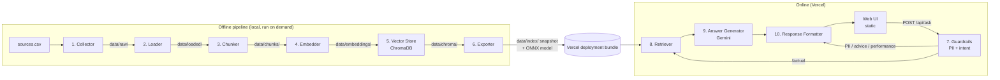

# Architecture — Mutual Fund FAQ Assistant (Facts-Only Q&A)

This document describes how the system in [PRD.md](PRD.md) is built. It covers HDFC Mutual Fund and four schemes: HDFC Large Cap, HDFC Flexi Cap, HDFC ELSS Tax Saver and HDFC Mid Cap.

## 1. Decisions

| Topic | Decision |
|---|---|
| Answer LLM | **Google Gemini, free tier.** The model name is set in `config.yaml`. The API key is `GEMINI_API_KEY`, kept in `.env`. |
| Secrets | `.env` is git-ignored. `.env.example` lists `GEMINI_API_KEY=` with **no real value**. On Vercel the key is set as a project environment variable. |
| Embeddings | `sentence-transformers/all-MiniLM-L6-v2` (free, runs locally). The same model embeds both the chunks and the user's question. |
| Vector store | **ChromaDB**, persisted on disk. It is the store the offline pipeline builds and checks. |
| Hosting | **Web app on Vercel.** A static frontend plus one Python serverless function (`/api/ask`). |
| Sources | 16 official URLs in [`sources.csv`](sources.csv) (columns `id, publisher, scheme, doc_type, url`). Allowed values and the domain rule are in `config.yaml` (§6). |
| Language | Python 3.12 for the pipeline and API. Plain HTML/CSS/JS for the UI. |

### Why the runtime does not load ChromaDB or PyTorch on Vercel

Vercel Python functions have a bundle size limit (about 250 MB unzipped at the time of writing). `sentence-transformers` pulls in PyTorch, and `chromadb` brings many dependencies of its own. Together they go well over that limit. So the system is split into two parts:

- **Offline (on your machine):** Collect → Load → Chunk → Embed → Store in ChromaDB → Export. This runs the full Python stack.
- **Online (on Vercel):** the Retriever and Answer Generator. They use a **read-only snapshot exported from ChromaDB**, and an **ONNX copy of all-MiniLM-L6-v2** to embed the question. That runtime needs only `onnxruntime`, `tokenizers` and `numpy`.

The corpus is small (15–25 pages, a few hundred chunks). Exact cosine search over a NumPy matrix takes about a millisecond and returns the same ranking as ChromaDB's search. A parity test (§6) checks that the ONNX query embeddings match the sentence-transformers embeddings, and that the snapshot's top-k results match ChromaDB's.

## 2. System overview



Each numbered box is its own component, with its own module, CLI entry point and saved output.

## 3. Repository layout

```
hdfc-mf-faq-rag/
├── PRD.md
├── architecture.md
├── README.md
├── implementation.md
├── README.md
├── config.yaml                 # models, chunking, retrieval, paths, collect, templates
├── .env.example                # GEMINI_API_KEY=   (no real value)
├── .env                        # real key — git-ignored
├── .gitignore                  # .venv, .env, data/* except data/index, .vercel
├── .vercelignore               # keeps offline data, tests and eval out of the deployment
├── sources.csv                 # 16 official URLs: id, publisher, scheme, doc_type, url
├── requirements-pipeline.txt   # offline: requests, trafilatura, pypdf, pdfplumber, sentence-transformers, chromadb, optimum[onnxruntime], ...
├── requirements.txt            # runtime (Vercel): onnxruntime, tokenizers, numpy, google-genai, fastapi, pyyaml, python-dotenv
├── vercel.json
├── pipeline/
│   ├── __init__.py
│   ├── collect.py              # Component 1 — Collector
│   ├── load.py                 # Component 2 — Loader
│   ├── chunk.py                # Component 3 — Chunker
│   ├── embed.py                # Component 4 — Embedder
│   ├── store.py                # Component 5 — Vector Store (ChromaDB)
│   ├── export.py               # Component 6 — Exporter
│   └── run_all.py              # runs 1→6 in order
├── app/
│   ├── __init__.py
│   ├── config.py               # reads config.yaml + GEMINI_API_KEY
│   ├── sources.py              # is_allowed_host(): domain rule shared by Collector and API
│   ├── guardrails.py           # Component 7 — Guardrails
│   ├── retriever.py            # Component 8 — Retriever
│   ├── generator.py            # Component 9 — Answer Generator (Gemini)
│   └── formatter.py            # Component 10 — Response Formatter
├── api/
│   └── ask.py                  # Vercel function: POST /api/ask (FastAPI)
├── scripts/
│   └── ask.py                  # CLI for asking questions without HTTP (local testing)
├── public/
│   ├── index.html              # Tiny UI
│   ├── app.js
│   └── style.css
├── data/
│   ├── manual/                 # Component 1 input: pages saved by hand where downloads are blocked
│   ├── raw/                    # Component 1 output: original HTML/PDF + manifest.json
│   ├── loaded/                 # Component 2 output: <id>.txt + documents.jsonl
│   ├── chunks/                 # Component 3 output: chunks.jsonl
│   ├── embeddings/             # Component 4 output: embeddings.npy, ids.json, meta.json
│   ├── chroma/                 # Component 5 output (not deployed)
│   └── index/                  # Component 6 output (committed + deployed)
├── eval/
│   ├── test_questions.yaml     # PRD §10 acceptance tests + edge cases
│   ├── run_eval.py             # runs against local or deployed URL
│   └── sample_qa.md            # deliverable: 5–10 Q&As with links (generated)
└── tests/
    ├── __init__.py
    ├── test_sources.py         # domain rule: subdomains allowed, lookalikes rejected
    ├── test_parity.py          # ONNX vs sentence-transformers; snapshot vs ChromaDB
    └── test_guardrails.py      # PII / advice / performance / out-of-scope cases
```

## 4. Offline pipeline components

Every stage reads only the previous stage's saved output. So any stage can be run again on its own, for example to re-chunk without fetching again: `python -m pipeline.chunk`. Only the Collector uses the network.

### Component 1 — Collector (`pipeline/collect.py`)

| | |
|---|---|
| **Input** | `sources.csv` |
| **Does** | Checks every row: unique `id`, `https://` URL, an allowed host (see the domain rule below), and `publisher`, `doc_type` and `scheme` values taken from the allowed lists in `config.yaml`. If any row is invalid, nothing is downloaded. Fetches **only the URLs listed**, one `GET` each. It never follows links, never fetches embedded resources and never crawls. Redirects are allowed only if the final host also passes the domain rule. Uses the user agent, timeout and delay from config. |
| **Output** | `data/raw/<id>.<html\|pdf>` (the original bytes) and `data/raw/manifest.json` with `{id, url, final_url, publisher, doc_type, scheme, fetched_on, http_status, content_type, bytes, sha256, file}` |
| **Saved copies** | `www.hdfcfund.com` blocks all automated requests (Akamai, HTTP 403). For those rows only, a page saved by hand from a browser is placed in `data/manual/<id>.html`. It is used only when the download fails, and rejected if it is an "Access Denied" page or its "saved from" URL names a different page. Its manifest entry is marked `method: "manual"`, with the save date as `fetched_on`. |
| **Fails if** | Any row is invalid, `data/manual/` holds a file not named after a listed id, or fewer than 15 sources are fetched or supplied |

**Allowed values** (from `config.yaml`; exact, case-sensitive match):

| Column | Allowed values |
|---|---|
| `publisher` | `HDFC MF`, `SEBI`, `AMFI` |
| `doc_type` | `scheme_page`, `factsheet`, `kim`, `sid`, `learning_page`, `statement_guide`, `regulator_faq`, `investor_guide` |
| `scheme` | `HDFC Large Cap`, `HDFC Flexi Cap`, `HDFC ELSS Tax Saver`, `HDFC Mid Cap`, `general` |

**Domain rule:** take the URL's host, lowercased. It is allowed if it **equals** an allow-listed domain, or **ends with `.` followed by** an allow-listed domain. The allow-list is `hdfcfund.com`, `sebi.gov.in` and `amfiindia.com`.
- Allowed: `www.hdfcfund.com`, `files.hdfcfund.com`, `investor.sebi.gov.in`, `www.sebi.gov.in`, `www.amfiindia.com`.
- Rejected: `evilhdfcfund.com` (no dot before the domain), `hdfcfund.com.example.net` (the domain isn't at the end), and any `http://` URL.
- The same rule is applied to the final URL after redirects, and to every `source_url` the app returns.

### Component 2 — Loader (`pipeline/load.py`)

| | |
|---|---|
| **Input** | `data/raw/` + `manifest.json` (no network access) |
| **Does** | **Scheme pages** (`doc_type: scheme_page`): reads the fund facts from the page's `__NEXT_DATA__` JSON. It requires `exitLoad`, `entryLoad`, `minimumSip` and `terDirecct` (the site's own spelling), uses `lockInValue`, `risk` and `benchmark` when present, and writes them as labelled lines with units. It stops with an error if the JSON or a required field is missing, and leaves out NAV, returns, AUM and the Regular-plan TER. **Other HTML:** pulls the main text out with trafilatura, falling back to `<main>`/`<article>`. Pulls text out of PDFs with pdfplumber (duplicate characters removed; pypdf as a per-page fallback), splitting multi-column pages (the factsheet) at their column gutters, and adds `[page N]` markers. Normalises whitespace, removes repeated headers and footers, and keeps `%`, `₹` and dates exactly as written. Flags documents with fewer than 300 characters. |
| **Output** | `data/loaded/<id>.txt` and `data/loaded/documents.jsonl` (`{id, url, publisher, doc_type, scheme, fetched_on, char_count, text}`) |

### Component 3 — Chunker (`pipeline/chunk.py`)

| | |
|---|---|
| **Input** | `data/loaded/documents.jsonl` |
| **Does** | Splits text by headings and paragraphs first, then by token count. **Chunk size must stay under 256 word pieces**, because all-MiniLM-L6-v2 silently truncates longer input. Defaults: `chunk_size_tokens: 200`, `chunk_overlap_tokens: 40`. Keeps table rows (for example exit load slabs) in the same chunk where possible. **Scheme pages (s01–s04) are split one chunk per labelled fact** (TER, exit load, entry load, minimum SIP, lock-in, riskometer, benchmark), each prefixed with the scheme name and plan, e.g. `HDFC ELSS Tax Saver Fund (Direct Plan) - Lock-in period: 3 years`. A single-fact chunk matches a single-fact question far better than the whole fact list does (labels and required facts: `chunking.fact_chunks`). Copies the source's metadata onto each chunk. |
| **Output** | `data/chunks/chunks.jsonl`, with one record per chunk: `{chunk_id, source_id, url, publisher, doc_type, scheme, fetched_on, text, token_count}` |

### Component 4 — Embedder (`pipeline/embed.py`)

| | |
|---|---|
| **Input** | `data/chunks/chunks.jsonl` |
| **Does** | Embeds each chunk with sentence-transformers `all-MiniLM-L6-v2` (384 dimensions, mean pooling, L2-normalised). |
| **Output** | `data/embeddings/embeddings.npy` (N × 384 float32) and `data/embeddings/ids.json` (row order → `chunk_id`), plus the model name and version in `data/embeddings/meta.json` |

### Component 5 — Vector Store (`pipeline/store.py`)

| | |
|---|---|
| **Input** | Embeddings + chunks |
| **Does** | Upserts the precomputed vectors (not ChromaDB's own embedding function), documents and metadata into a persistent ChromaDB collection (`hdfc_mf_faq`, cosine distance). Rerunning replaces records rather than duplicating them. Runs a smoke query per scheme to check it. |
| **Output** | `data/chroma/` (persistent client directory). Used locally for development and evaluation; not deployed. |

### Component 6 — Exporter (`pipeline/export.py`)

| | |
|---|---|
| **Input** | The ChromaDB collection |
| **Does** | Reads every record back **from ChromaDB** and writes a compact read-only snapshot. Exports all-MiniLM-L6-v2 to ONNX (via `optimum`) with its tokenizer, unless an exported copy is already cached. |
| **Output** | `data/index/vectors.npy`, `data/index/records.json` (chunk text + metadata), `data/index/index_meta.json` (`{embedding_model, built_on, corpus_last_updated, count}`), and `data/index/model/` (ONNX model + `tokenizer.json`) |

`corpus_last_updated` is the latest `fetched_on` date across all sources. Each answer also shows the `fetched_on` date of the source it cites (§5, Component 10).

`pipeline/run_all.py` runs Components 1 → 6 in order.

## 5. Online components (Vercel)

Request path: `POST /api/ask` with body `{ "question": "..." }` → `api/ask.py` → components 7 → 8 → 9 → 10 → JSON response. `api/ask.py` rejects empty questions and questions over 500 characters with HTTP 400. `scripts/ask.py` runs the same path from the command line for local testing.

### Component 7 — Guardrails (`app/guardrails.py`)

Runs **before** retrieval and before anything is logged.

1. **PII check (regex):** PAN `[A-Z]{5}[0-9]{4}[A-Z]`, Aadhaar (12 digits, with or without spaces), email addresses, Indian mobile numbers, OTP-like strings ("OTP" next to 4–8 digits), and folio/account numbers (long digit runs next to "folio", "account" or "a/c"). If any match: return the PII-warning response. The question is **not** sent to Gemini and **not** logged.
2. **Intent check (rules first):**
   - *Advice or opinion:* should I, better, best, recommend, buy, sell, switch, good for me, which fund → refusal.
   - *Performance:* returns, CAGR, NAV growth, performance, gave X% → return the factsheet link for the scheme detected, and no numbers.
   - *Out of scope:* names a fund or AMC outside the four schemes → out-of-scope response.
   - Otherwise the question is treated as *factual*.
3. **Scheme detection:** maps aliases (for example "ELSS", "tax saver", "flexi cap") to a scheme name. The Retriever uses it as a metadata filter.

The checks run in a fixed order: PII → advice → performance → out of scope → factual. So a question that mixes a fact with an advice request is refused.

The Gemini prompt (Component 9) is also a second safeguard for any advice question that gets past the rules. If Gemini returns `is_advice=true`, `api/ask.py` turns the response into a refusal.

### Component 8 — Retriever (`app/retriever.py`)

- When the function cold-starts, it loads `data/index/` once and keeps it in module scope.
- Embeds the question with the ONNX model (same mean pooling and L2 normalisation as Component 4).
- Filters to the detected scheme's chunks plus `scheme == general` chunks, then takes the cosine top-k (`top_k: 5`).
- If the best score is below `min_score` (in config), it returns "not found in sources". The Generator is not called.

### Component 9 — Answer Generator (`app/generator.py`)

- Uses Gemini through the `google-genai` SDK. The model is set by `llm.model` in config, and the key comes from `GEMINI_API_KEY`.
- The prompt contains the system rules plus the retrieved chunks, each labelled `[C1]…[C5]`.
- System rules: answer only from the context; use 3 sentences or fewer; never compute or compare returns; never give advice; if the context does not answer the question, set `answerable=false`.
- Gemini returns **structured JSON**: `{ "answerable": bool, "answer": str, "cited_chunk": "C2", "is_advice": bool }`.
- **Citations come from the chunk the model names, never from URLs the model writes.** The app maps `cited_chunk` to that chunk's `url`, so made-up links are impossible.
- Free-tier limits: `temperature: 0`, a short `max_output_tokens`, a timeout, and one retry with backoff on HTTP 429. If the call still fails, the user gets a "service busy, please retry" message.

### Component 10 — Response Formatter (`app/formatter.py`)

Builds the final response in one consistent shape:

```json
{
  "type": "answer | refusal | performance | pii_warning | not_found | out_of_scope | error",
  "text": "≤3 sentences",
  "source_url": "exactly one URL",
  "last_updated": "YYYY-MM-DD"
}
```

- **answer:** the Gemini text, plus the cited chunk's URL and its `fetched_on` date. The formatter checks the answer is 3 sentences or fewer and trims it if not.
- **refusal / performance / not_found / out_of_scope:** fixed templates from `config.yaml`. They link to an educational URL (AMFI/SEBI) or the scheme's factsheet.
- **pii_warning:** a fixed template. It has no source link and no echo of the user's input.

### Web UI (`public/`)

- Static files served by Vercel, with no framework.
- Shows a welcome line, **three clickable example questions** (from PRD §FR6), an input box and an answer card. The card shows the text, a "Source" link and "Last updated from sources: …".
- A persistent disclaimer reads **"Facts-only. No investment advice."** (this is the disclaimer-snippet deliverable).
- The UI does not store questions (no localStorage, no analytics). Server text is rendered with `textContent`, never `innerHTML`.
- Local development uses `vercel dev`. If the Vercel CLI isn't available, a dev-only static mount in the FastAPI app (enabled by `DEV_STATIC=1`) serves `public/`.

## 6. Configuration

### `config.yaml` (committed)

```yaml
embedding:
  model: sentence-transformers/all-MiniLM-L6-v2
  onnx_dir: data/index/model
  dim: 384

chunking:
  chunk_size_tokens: 200     # must stay < 256 (model's max sequence length)
  chunk_overlap_tokens: 40
  fact_chunks:               # scheme pages: one chunk per labelled fact
    doc_types: [scheme_page]
    facts:                   # line label from pipeline.load -> label in the chunk
      - {line: "Total Expense Ratio (TER), Direct Plan", label: "Total Expense Ratio (TER)", required: true}
      - {line: "Exit load", label: "Exit load", required: true}
      # … entry load, minimum SIP (required); lock-in period, riskometer, benchmark (optional)

vector_store:
  persist_dir: data/chroma
  collection: hdfc_mf_faq
  distance: cosine

retrieval:
  top_k: 5
  min_score: 0.35            # tune using eval/

llm:
  provider: gemini
  model: gemini-2.5-flash    # any free-tier Gemini model; check the current free-tier list
  temperature: 0
  max_output_tokens: 256
  timeout_s: 20

answer:
  max_sentences: 3
  disclaimer: "Facts-only. No investment advice."

# Host allowed if it equals an entry or ends with "." + entry (subdomains allowed)
source_allowlist: [hdfcfund.com, sebi.gov.in, amfiindia.com]

allowed_publishers: [HDFC MF, SEBI, AMFI]
allowed_doc_types:
  - scheme_page
  - factsheet
  - kim
  - sid
  - learning_page
  - statement_guide
  - regulator_faq
  - investor_guide
allowed_schemes:
  - HDFC Large Cap
  - HDFC Flexi Cap
  - HDFC ELSS Tax Saver
  - HDFC Mid Cap
  - general

paths:
  sources_csv: sources.csv
  manual_dir: data/manual      # pages saved by hand from a browser when a site blocks downloads
  raw_dir: data/raw
  loaded_dir: data/loaded
  chunks_dir: data/chunks
  embeddings_dir: data/embeddings
  index_dir: data/index

collect:
  user_agent: "hdfc-mf-faq-rag/0.1 (educational prototype)"
  timeout_s: 30
  delay_between_requests_s: 1.0

loader:
  min_chars: 300               # flag documents shorter than this
  next_data:                   # scheme pages: read facts from <script id="__NEXT_DATA__">
    doc_types: [scheme_page]
    path: props.pageProps.singleFundResponse.data.details.0.Overview.data
    required: [terDirecct, exitLoad, entryLoad, minimumSip]   # "terDirecct" is the site's spelling
    optional: [lockInValue, risk, benchmark]

templates:
  refusal_link: "<AMFI/SEBI investor-education URL from sources.csv>"
  factsheet_links: {}        # scheme -> official factsheet URL, filled once sources are added
```

### `.env` (git-ignored) / `.env.example` (committed)

```
# .env.example
GEMINI_API_KEY=
```

`app/config.py` reads `GEMINI_API_KEY` from the process environment. Locally it comes from `.env` via `python-dotenv`; on Vercel it comes from the project's environment variables. The function refuses to start if the key is missing. The key is never logged or returned to the browser.

## 7. Deployment (Vercel)

- `vercel.json` routes `/api/ask` to `api/ask.py` (Python runtime) and serves `public/` as static files.
- The Python function installs only `requirements.txt`. The heavy offline libraries (`torch`, `sentence-transformers`, `chromadb`) are not included.
- `data/index/` and `config.yaml` are committed and bundled with the function (`includeFiles` in `vercel.json`). If the ONNX file is too big for the repo, use Git LFS or a CI step that rebuilds it.
- `.vercelignore` excludes `data/raw/`, `data/loaded/`, `data/chunks/`, `data/embeddings/`, `data/chroma/`, `.venv/`, `tests/`, `eval/` and `requirements-pipeline.txt`.
- `GEMINI_API_KEY` is set in Vercel → Project → Settings → Environment Variables.
- **Updating the corpus:** edit `sources.csv` → `python -m pipeline.run_all` → run the eval and parity tests → commit `data/index/` → Vercel redeploys.

## 8. Privacy and logging

- PII is checked before anything else runs, and questions that contain PII are never logged or sent to Gemini.
- Logs contain only `{type, scheme, top_score, cited_source_id, latency_ms}`, not the question text.
- No database, no user accounts and no cookies.

## 9. Evaluation and tests

| Test | What it checks |
|---|---|
| `tests/test_parity.py` | ONNX vs sentence-transformers embeddings (cosine > 0.999 on sample texts), and snapshot top-k vs ChromaDB top-k (same IDs) |
| `tests/test_guardrails.py` | The PII regexes and intent rules, with at least 5 positive and negative examples per category. Also checks that PII questions never reach Gemini. |
| `eval/run_eval.py` | The 10 acceptance cases in PRD §10 plus the edge cases in `eval/test_questions.yaml`, against a local or deployed URL. Checks response type, exactly one allow-listed URL (none for `pii_warning`), 3 sentences or fewer, a last-updated line, and no `%` or return figures in answers |

`eval/run_eval.py` also produces `eval/sample_qa.md` (the Sample Q&A deliverable).

## 10. Known limits

- Facts are only as current as the last pipeline run, which is why every answer shows its source's fetch date.
- Rule-based intent detection can miss unusually worded advice questions. The Gemini `is_advice` flag is the second check.
- PDF tables (for example exit load slabs or TER tables) may extract imperfectly. Check the saved chunks.
- The Gemini free tier has rate limits, so many users at once may get "service busy" responses.
- The ONNX export must stay in sync with the offline model version. The parity test enforces this.
